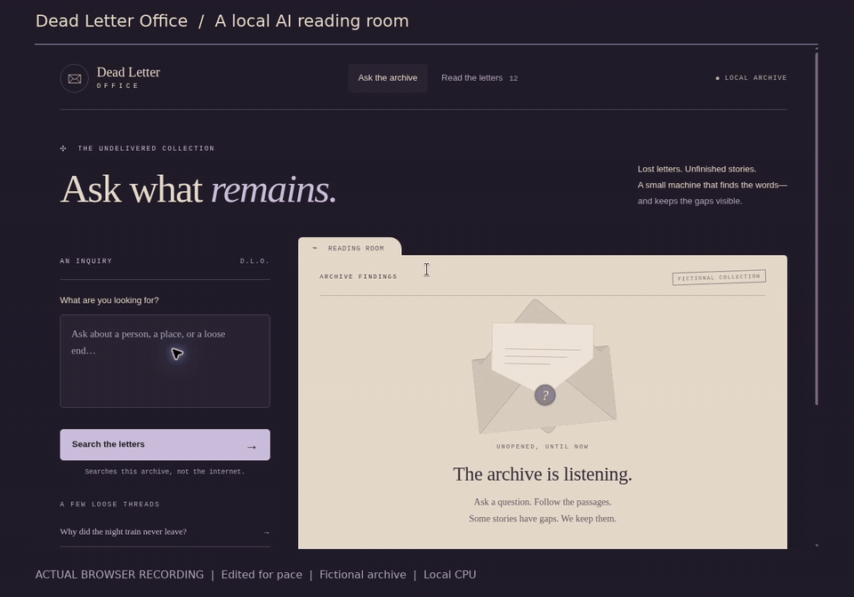
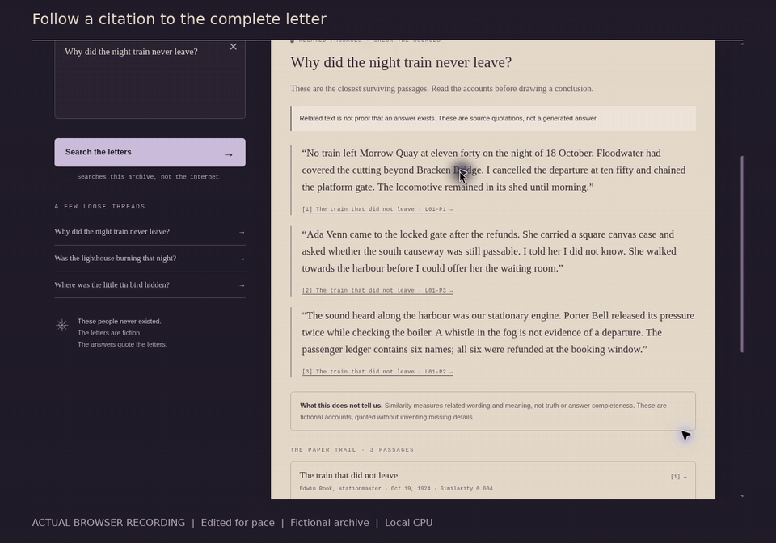
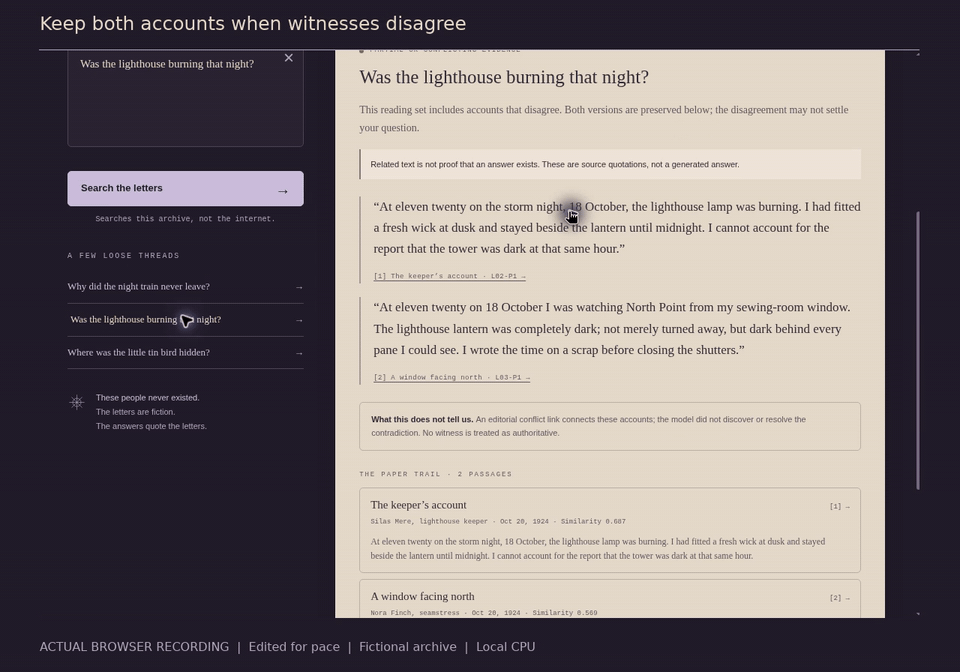
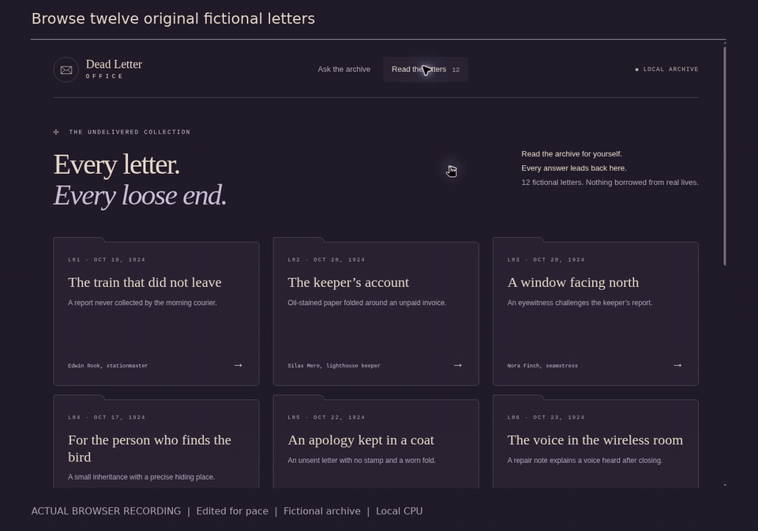

# Dead Letter Office

### Ask what remains. Read the words that survived.

[](docs/media/demo.mp4)

[Watch the 78-second demo](docs/media/demo.mp4) · [Run locally](#run-locally) · [How it works](#how-it-works) · [Test results](#what-survived-testing)

Twelve fictional letters from a coastal town in 1924. A train that never left. A repeating voice in an empty room. Two witnesses who disagree about the light in a tower.

Ask about the loose ends. A local MiniLM model finds related passages, and every quotation links back to its complete letter. The app preserves contradictions and leaves missing facts unfilled. Nobody is impersonated.

## Inside the reading room

### Search in your own words


Semantic search finds related wording; TF-IDF helps with names and objects. The model runs on your CPU. No question goes to a hosted AI API.

### Follow the paper trail



Click a citation to see its exact paragraph in the full letter. Export the findings with source IDs when you want to keep them.

### Keep the difficult parts



The keeper says the lamp was lit. Another witness says it was dark. Both accounts stay visible. Those conflict links are editorial, not something the model claims to have discovered.

### Read beyond the search result



All twelve letters are readable without a query. A search result is an entry point, not the whole archive.

<sub>The GIFs come from the actual browser recording. The overview is sped up; the feature clips preserve their captured pace. [Capture and edit notes](docs/media/capture-notes.json) · [Still screenshot](docs/media/hero.png)</sub>

## Run locally

**Python 3.12 · current browser · CPU only.** From the project directory:

```bash
python -m venv .venv
source .venv/bin/activate
python -m pip install -r requirements.txt
python scripts/fetch_model.py
python server.py
```

Open **http://127.0.0.1:8765**. Windows PowerShell activation: `.venv\Scripts\Activate.ps1`.

Setup downloads about 91 MB of pinned model files and checks their SHA-256 hashes. After setup, the app works offline. No account, API key, GPU, paid service, or JavaScript build step is required. Use `python server.py --port 8766` if the default port is busy.

Try:

- “Why did the night train never leave?”
- “Was the lighthouse burning that night?”
- “Where was the little tin bird hidden?”
- “Who owned the mitten on the lighthouse stairs?”

The last one can find a useful paragraph that says the answer is unknown.

## How it works

```text
Question + source paragraphs
          │
          ├─ MiniLM → 384-dimensional semantic vectors
          └─ TF-IDF → lexical similarity
                         │
                  50/50 hybrid ranking
                         │
               source-selection rules
                         │
          exact quotations + complete letters
```

The open-weight model is [`all-MiniLM-L6-v2`](https://huggingface.co/sentence-transformers/all-MiniLM-L6-v2), running through ONNX Runtime. There is no text-generation model. Source titles and bylines supply context; evaluation questions never enter the index.

Displayed similarity is neural cosine, **not confidence**. Narrow, separately documented scope rules reject some live-data and transaction requests. They are not a general answerability classifier.

## What survived testing

| Check | Recorded result |
|---|---|
| Unit and API tests | 15 passed, including a clean-source reinstall; real model inference |
| Independent HTTP probes | 19/19 passed |
| Fresh answerable smoke questions | All required evidence returned on 12/12 |
| Fresh missing-fact questions | Explicit gap evidence returned on 2/2 |
| Citation and literal-quote integrity | Zero errors in the fresh 18-case smoke |
| Fresh difficult out-of-domain questions | Only 1/4 abstained |

**That last row matters.** A question about buying a scarf today can retrieve a fictional 1924 parcel. A request for modern repair instructions can retrieve an old workshop letter. The app quotes its source faithfully, but the source can still be irrelevant. Read the evidence before drawing a conclusion.

These are small, authored tests on one fictional corpus. They do not establish general accuracy. On the fresh set, neural-only retrieval beat the hybrid at top-1; both found supporting evidence in the top three for all twelve answerable cases. The full audit includes every failure, earlier development runs, and a rejected cross-encoder experiment.

[Read the independent audit](evidence/REPORT-02.md) · [Development and model details](TECHNICAL-NOTES.md) · [Verification boundaries](VALIDATION.md)

```bash
python -m unittest discover -s tests -v
python scripts/evaluate.py
node --check web/app.js
```

The reproducible browser-check script is supplied but was not run in the restricted build sandbox. Separately checked browser flows include search, source open/close, catalogue navigation, and Back while a letter is open. Mobile and full accessibility conformance are not claimed as tested.

## Private by construction

- The server binds to `127.0.0.1`. It is a local development server, not a public hosting setup.
- No analytics, remote fonts, authored query logs, cookies, or browser-storage persistence.
- Every sample is original fiction. No personal emails or real deceased person's records were used.
- The demo archive is read-only. There are no uploads, account actions, purchases, or impersonated replies.

## Project map

| Path | Purpose |
|---|---|
| [`archive.py`](archive.py) | Local model, ranking, selection, and exact-quote assembly |
| [`server.py`](server.py) | Loopback API and static server |
| [`web/`](web/) | Reading room interface; vanilla HTML, CSS, and JavaScript |
| [`data/`](data/) | Fictional letters and development questions |
| [`tests/`](tests/) | Model and HTTP tests; optional browser flow checks |
| [`evidence/`](evidence/) | Actual evaluation outputs, failure reports, model provenance |
| [`DESIGN.md`](DESIGN.md) | Visual system and interaction decisions |

Built from scratch on October 30, 2026 for [Ghost in the Machine](https://dev.to/challenges/hacktoberfest-week4-2026-10-26).

## License and credits

Project code and original fictional letters: [MIT](LICENSE). MiniLM weights: [Apache-2.0](THIRD_PARTY_MODEL_LICENSE.txt), credited to the upstream Sentence Transformers project. Exact revision, download URLs, and hashes are in the [model manifest](evidence/model-manifest.json).

ONNX Runtime, Hugging Face Tokenizers, NumPy, scikit-learn, and SciPy retain their own licenses and notices. The runtime does not call hosted AI services. The project does not claim authorship of the pretrained model or its training data.
